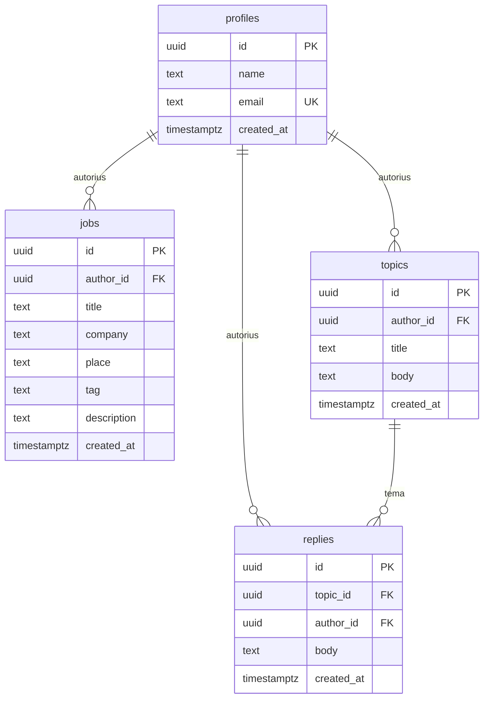
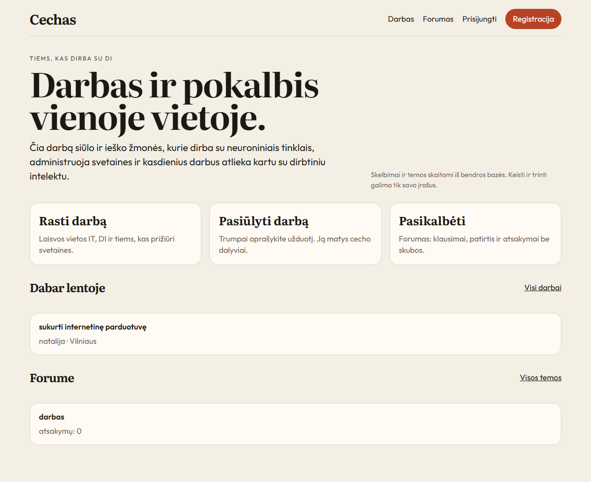
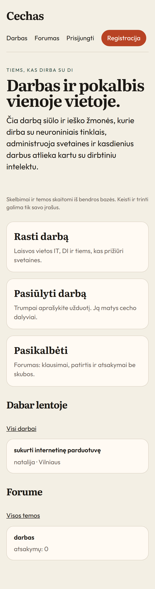
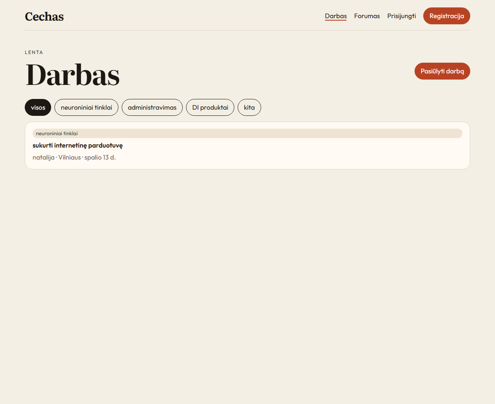
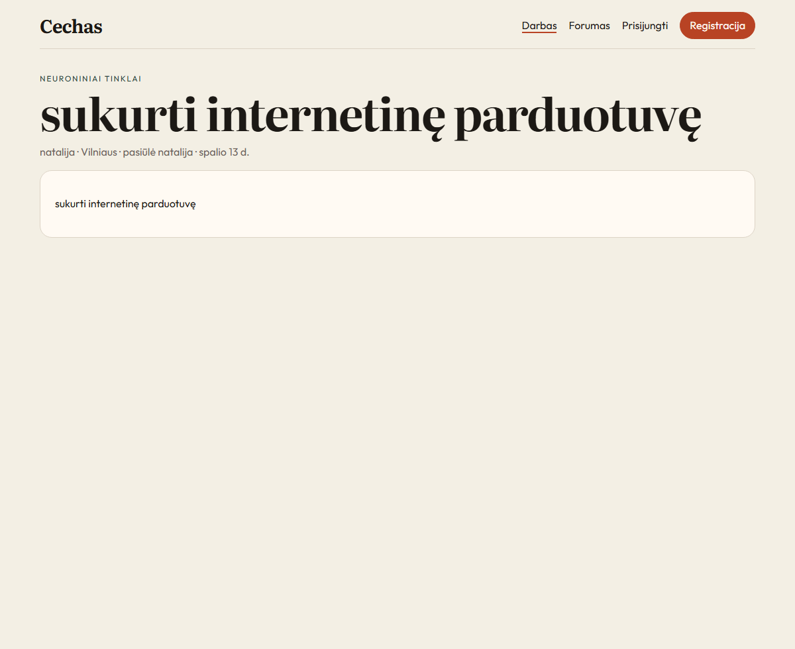
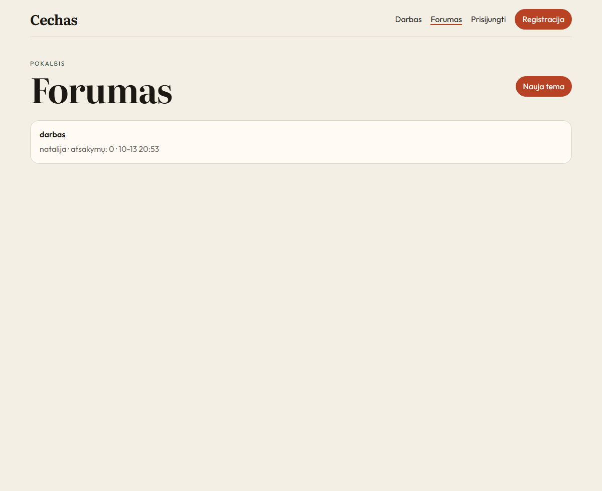
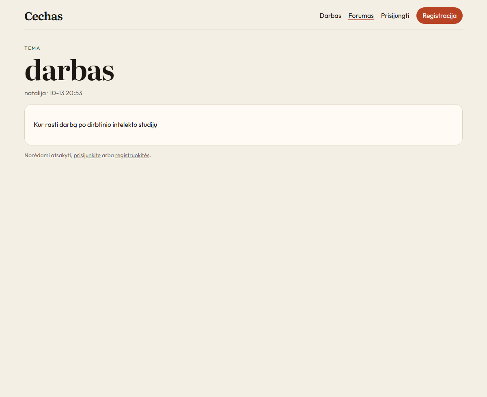
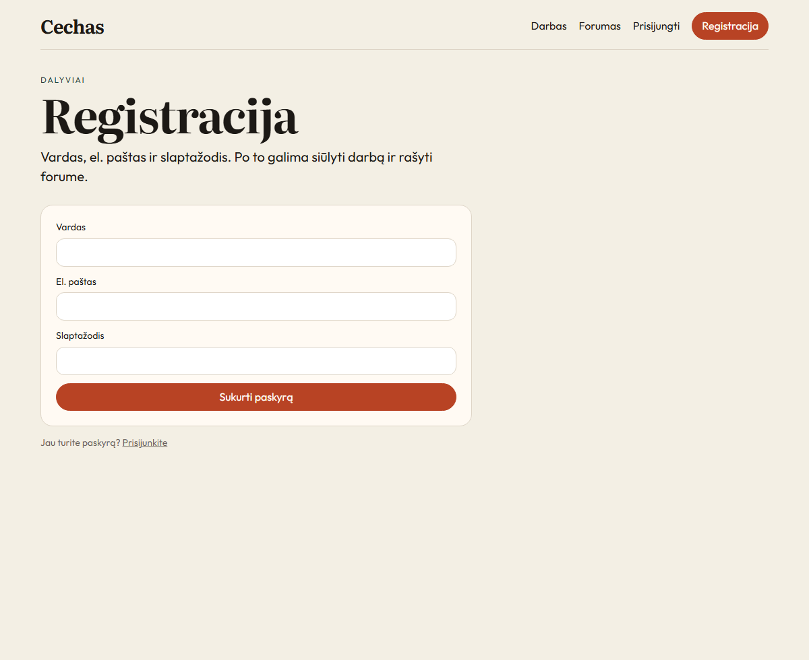
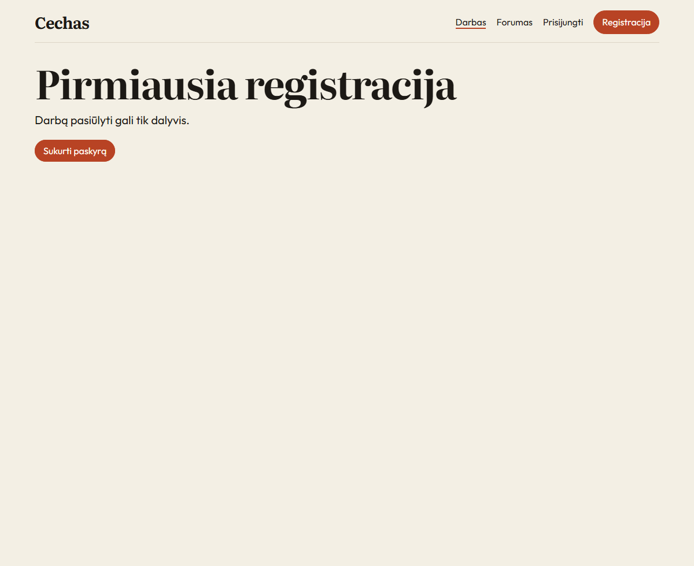

```bash
npm install
npm run dev
```
# Cechas

Cechas — svetainė žmonėms, kurie dirba su dirbtiniu intelektu, neuroniniais tinklais ir svetainių administravimu. Dalyvis registruojasi, ieško darbo, siūlo darbą ir bendrauja forume.

Saugykla: [github.com/artbaltica-lang/Cechas](https://github.com/artbaltica-lang/Cechas)

Svetainė paleidžiama vietoje. Atskiro adreso internete nėra: projekto raktai lieka vietiniame `.env` ir į saugyklą nepatenka.

## Technologijos

- React 19 ir React Router 7 — puslapiai ir perėjimai
- Vite 7 — surinkimas ir vietinis serveris
- JavaScript
- Supabase: Postgres, prisijungimas el. paštu ir slaptažodžiu, eilučių prieigos taisyklės

Slaptažodį saugo Supabase prisijungimo sistema. Svetainės lentelėse jo nėra. Į naršyklę patenka tik viešas anon raktas. `service_role` raktas programoje nenaudojamas.

## Paleidimas

Komandos vykdomos aplanke `ceh`.
Prieš paleidžiant nukopijuokite `.env.example` į `.env`. PowerShell: `copy .env.example .env`. Bash: `cp .env.example .env`.

Į `.env` įrašykite savo Supabase projekto adresą ir anon raktą. Failas `.env.example` turi tik kintamųjų vardus ir pavyzdžius. Pats `.env` įrašytas į `.gitignore`.

Svetainė atsidaro adresu http://127.0.0.1:5173/

Kaip lenteles sukurti naujame Supabase projekte, parašyta [docs/database.md](docs/database.md).

## Pirmoji versija

Smulkiau ir tai, kas sąmoningai palikta vėlesniam laikui, — [docs/mvp.md](docs/mvp.md).

| Galimybė | Būsena |
|---|---|
| Registracija ir prisijungimas | padaryta |
| Darbų lenta: sąrašas, filtras pagal sritį, skelbimo puslapis | padaryta |
| Naujas skelbimas, savo skelbimo keitimas ir trynimas | padaryta |
| Forumas: temų sąrašas, temos puslapis, nauja tema, atsakymas | padaryta |
| Savo temos ir savo atsakymo keitimas ir trynimas | padaryta |
| Vardo keitimas ir savo paskyros trynimas | padaryta |
| Lentos ir forumo skaitymas be prisijungimo | padaryta |
| Atsiliepimas į skelbimą ir susirašinėjimas | neįeina į pirmąją versiją |
| Paieška pagal tekstą | neįeina į pirmąją versiją |
| Moderavimas, skundai, rolės | neįeina į pirmąją versiją |
| Svetainės publikavimas internete | nepadaryta |

Svečias skaito skelbimus ir temas. Įrašo be prisijungimo sukurti negalima: darbo siūlymo ir naujos temos puslapiai prašo pirmiausia registruotis.

## Duomenų modelis

Keturios lentelės: `profiles`, `jobs`, `topics`, `replies`. Laukai ir apribojimai — [docs/mvp.md](docs/mvp.md).



`profiles.id` sutampa su prisijungimo paskyra. Dalyvio trynimas pašalina jo skelbimus, temas ir atsakymus. Temos trynimas pašalina atsakymus jos viduje.

## Migracijos ir prieiga

SQL yra aplanke `supabase/migrations/`:

1. `20261013190000_init.sql` — lentelės, ryšiai, apribojimai, skaitymas ir kūrimas.
2. `20261013203000_crud.sql` — autorius gali keisti ir trinti savo eilutes.

Kas ką mato ir kas ką keičia, aprašyta [docs/database.md](docs/database.md). Riba nustatyta bazėje: svetimos eilutės pakeisti negalima net apeinant mygtuką sąsajoje.

## Ekrano nuotraukos

Pagrindinis puslapis: trys įėjimai ir naujausi įrašai iš bendros bazės.



Tas pats pagrindinis puslapis telefono plotyje: meniu ir kortelės susidėlioja vienas po kitu.



Darbų lenta ir filtras pagal sritį.



Skelbimo puslapis.



Forumas.



Tema. Be prisijungimo atsakyti negalima.



Registracija: vardas, el. paštas, slaptažodis.



Darbą pasiūlyti be prisijungimo negalima.



## Demonstracija

Trumpa rodymo eiga ir sprendimų paaiškinimas — [docs/presentation.md](docs/presentation.md).
