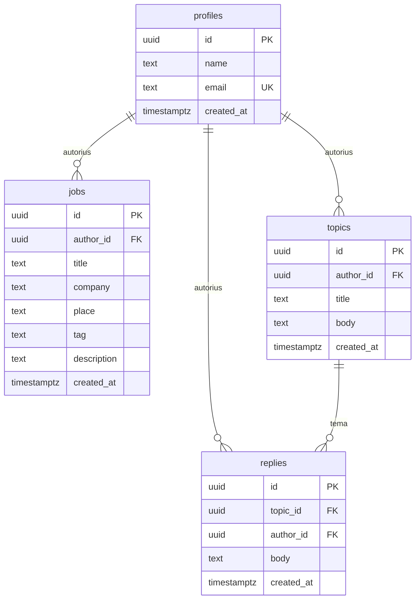

# Cechas — pirmoji versija ir duomenų modelis

Cechas — svetainė tiems, kas dirba su dirbtiniu intelektu, neuroniniais tinklais ir svetainių administravimu. Dalyvis registruojasi, ieško darbo, siūlo darbą ir bendrauja forume.

Duomenys skaitomi ir rašomi į bendrą bazę. Žemiau užfiksuota, kas įeina į pirmąją versiją ir kaip eilutės susijusios.

## Kas įeina į pirmąją versiją

- Registracija ir prisijungimas. Slaptažodį saugo prisijungimo sistema, ne profilio lentelė.
- Darbų lenta: sąrašas, filtras pagal sritį, skelbimo puslapis, naujas skelbimas.
- Forumas: temų sąrašas, temos puslapis, nauja tema, atsakymas.
- Dalyvis mato visus skelbimus ir temas. Kurti juos gali tik prisijungęs naudotojas.
- Savo skelbimą, temą ir atsakymą galima pakeisti ir ištrinti. Svetimos eilutės lieka vietoje.
- Profilio trynimas pašalina jo skelbimus, temas ir atsakymus.

## Kas sąmoningai lieka vėlesniam laikui

- Atsiliepimas į skelbimą ir susirašinėjimas su autoriumi.
- Paieška pagal tekstą.
- Kelios sritys viename skelbime ir atskiras sričių žinynas.
- Moderatoriaus rolės, skundai, dalyvių blokavimas.
- Avataras, pranešimai, laiškai į paštą, išskyrus patį prisijungimą.
- Įmonių puslapiai atskirai nuo dalyvio.

Šios galimybės pirmojoje versijoje negauna savo lentelių, kad nebūtų saugomi duomenys, kurių svetainė dar nenaudoja.

## Įgyvendinimo būsena

| Galimybė | Būsena |
|---|---|
| Registracija ir prisijungimas. Slaptažodis lieka prisijungimo sistemoje | padaryta |
| Skelbimų sąrašas, filtras pagal sritį, skelbimo puslapis | padaryta |
| Naujas skelbimas nuo prisijungusio dalyvio | padaryta |
| Savo skelbimo keitimas ir trynimas | padaryta |
| Temų sąrašas, temos puslapis, nauja tema, atsakymas | padaryta |
| Savo temos ir savo atsakymo keitimas ir trynimas | padaryta |
| Autoriaus vardas kortelėje, paštas tik pačiam dalyviui | padaryta |
| Savo vardo keitimas | padaryta |
| Savo paskyros trynimas kartu su skelbimais, temomis ir atsakymais | padaryta |
| Atsiliepimas, susirašinėjimas, paieška, moderavimas, atskiri įmonių puslapiai | neįeina į pirmąją versiją |

Svetainė skaito ir rašo bendrą bazę per `src/services/store.js`. Keitimo mygtukai matomi tik eilutės autoriui. Pačią rašymo teisę tikrina bazė.

## 4.1. Lentelės

Sistemoje keturi atskiri objektai.

| Lentelė | Objektas | Ryšys |
|---|---|---|
| `profiles` | Dalyvis | Vienas dalyvis |
| `jobs` | Darbo skelbimas | Priklauso vienam dalyviui. Dalyvis turi daug skelbimų |
| `topics` | Forumo tema | Priklauso vienam dalyviui. Dalyvis turi daug temų |
| `replies` | Atsakymas temoje | Priklauso vienai temai ir vienam autoriui. Tema turi daug atsakymų |

Skelbimo sritis (`tag`) yra laukas lentelėje `jobs`, ne atskira lentelė. Pirmojoje versijoje skelbimas turi vieną sritį iš fiksuoto sąrašo: `neuroniniai tinklai`, `administravimas`, `DI produktai`, `kita`.

Slaptažodis nėra programos objektas. Jis neiškeliamas į savo lentelę.

## 4.2. Laukai

Privalomas laukas pažymėtas «taip». Jei reikšmė neperduota, bazė įrašo nurodytą numatytąją. Kiekvienos lentelės pirminis raktas — `id`.

### `profiles`

Dalyvis. Eilutė atsiranda kartu su prisijungimo paskyra, `id` sutampa su tos paskyros identifikatoriumi.

| Laukas | Tipas | Pirminis raktas | Privalomas | Numatyta | Prasmė |
|---|---|---|---|---|---|
| `id` | `uuid` | taip | taip | ne, imamas iš prisijungimo | Kas tai |
| `name` | `text` | ne | taip | ne | Vardas, nuo 2 iki 40 simbolių |
| `email` | `text` | ne | taip | ne | Paštas, unikalus, mažosiomis raidėmis |
| `created_at` | `timestamptz` | ne | taip | `now()` | Kada užsiregistravo |

### `jobs`

Darbo skelbimas.

| Laukas | Tipas | Pirminis raktas | Privalomas | Numatyta | Prasmė |
|---|---|---|---|---|---|
| `id` | `uuid` | taip | taip | `gen_random_uuid()` | Skelbimas |
| `author_id` | `uuid` | ne | taip | ne | Autorius, nuoroda į `profiles.id` |
| `title` | `text` | ne | taip | ne | Ką reikia padaryti, nuo 4 iki 120 simbolių |
| `company` | `text` | ne | taip | ne | Kas siūlo, iki 80 simbolių |
| `place` | `text` | ne | taip | `nuotoliniu būdu` | Kur darbas, iki 80 simbolių |
| `tag` | `text` | ne | taip | `kita` | Viena sritis iš sąrašo aukščiau |
| `description` | `text` | ne | taip | ne | Aprašymas, nuo 10 iki 2000 simbolių |
| `created_at` | `timestamptz` | ne | taip | `now()` | Kada paskelbta |

### `topics`

Forumo tema.

| Laukas | Tipas | Pirminis raktas | Privalomas | Numatyta | Prasmė |
|---|---|---|---|---|---|
| `id` | `uuid` | taip | taip | `gen_random_uuid()` | Tema |
| `author_id` | `uuid` | ne | taip | ne | Autorius, nuoroda į `profiles.id` |
| `title` | `text` | ne | taip | ne | Pavadinimas, nuo 4 iki 140 simbolių |
| `body` | `text` | ne | taip | ne | Pirmoji žinutė, nuo 10 iki 4000 simbolių |
| `created_at` | `timestamptz` | ne | taip | `now()` | Kada atidaryta |

### `replies`

Atsakymas temos viduje. Savo nuorodos į kitus atsakymus nėra: pirmojoje versijoje pokalbis plokščias.

| Laukas | Tipas | Pirminis raktas | Privalomas | Numatyta | Prasmė |
|---|---|---|---|---|---|
| `id` | `uuid` | taip | taip | `gen_random_uuid()` | Atsakymas |
| `topic_id` | `uuid` | ne | taip | ne | Tema, nuoroda į `topics.id` |
| `author_id` | `uuid` | ne | taip | ne | Autorius, nuoroda į `profiles.id` |
| `body` | `text` | ne | taip | ne | Tekstas, nuo 2 iki 4000 simbolių |
| `created_at` | `timestamptz` | ne | taip | `now()` | Kada parašyta |

Temos trynimas pašalina jos atsakymus. Dalyvio trynimas pašalina jo skelbimus, temas ir atsakymus.

## 4.3. Ryšiai

Ryšį nustato išorinis raktas. Tarp prisijungimo ir profilio ryšys vienas su vienu: viena paskyra turi lygiai vieną profilį. Kiti ryšiai — vienas su daug. Privalomo ryšio lauko palikti tuščio negalima, todėl trinant tėvą susijusios eilutės nelieka be savininko.

| Vaikinė lentelė | Išorinis raktas | Tėvas | Tipas | Trinant tėvą |
|---|---|---|---|---|
| `profiles` | `id` | prisijungimo paskyra | vienas su vienu | profilis trinamas kartu su prisijungimu |
| `jobs` | `author_id` | `profiles.id` | vienas su daug | šio dalyvio skelbimai trinami |
| `topics` | `author_id` | `profiles.id` | vienas su daug | šio dalyvio temos trinamos |
| `replies` | `topic_id` | `topics.id` | vienas su daug | šios temos atsakymai trinami |
| `replies` | `author_id` | `profiles.id` | vienas su daug | šio dalyvio atsakymai trinami |

Atsakymas laikosi ant dviejų ryšių iš karto. Jis negali rodyti į nesančią temą arba į svetimą dalyvį kaip į save: kuriant `author_id` lygus prisijungusiam naudotojui.

Jei ištrinti dalyvį, dingsta jo skelbimai ir temos. Kartu su temomis dingsta ir svetimi atsakymai jų viduje. Jei ištrinti tik temą, dingsta jos atsakymai, o tų atsakymų autoriai lieka.

Savo skelbimą, temą ar atsakymą dalyvis trina pats. Svetimos eilutės taip netrinamos. Jei ištrinti temą, kartu su ja išeina ir kitų žmonių atsakymai jos viduje.

`profiles.id` yra tas pats identifikatorius kaip prisijungimo paskyros. Atskitos slaptažodžių lentelės nėra.

## 4.4. Apribojimai ir prieiga

### Unikalumas

Paštas lauke `profiles.email` unikalus. Dvi paskyros su tuo pačiu adresu nekuriamos. Kiti tekstai gali kartotis: du skelbimai gali vadintis vienodai.

### Privalomi laukai

Tuščių palikti negalima vardo, pašto, autoriaus, antraštės, aprašymo, temos pavadinimo, atsakymo teksto ir sukūrimo laiko. Darbo vieta ir sritis irgi privalomos, bet jei jų neperdavė, bazė įrašo `nuotoliniu būdu` ir `kita`.

### Leistinos reikšmės

| Laukas | Taisyklė |
|---|---|
| `profiles.name` | nuo 2 iki 40 simbolių nukirpus tarpus |
| `profiles.email` | pašto formatas ir tik mažosios raidės |
| `jobs.title` | nuo 4 iki 120 simbolių |
| `jobs.company` | nuo 1 iki 80 simbolių |
| `jobs.place` | nuo 1 iki 80 simbolių |
| `jobs.tag` | tik `neuroniniai tinklai`, `administravimas`, `DI produktai`, `kita` |
| `jobs.description` | nuo 10 iki 2000 simbolių |
| `topics.title` | nuo 4 iki 140 simbolių |
| `topics.body` | nuo 10 iki 4000 simbolių |
| `replies.body` | nuo 2 iki 4000 simbolių |

Reikšmės už šio sąrašo bazė neįrašo.

### Kieno duomenys kam matomi

Skelbimus, temas ir atsakymus skaito visi, įskaitant svečią: lenta ir forumas atviri. Autoriaus vardas irgi atviras, jis reikalingas skelbimo kortelėje ir temoje.

Paštas matomas tik pačiam dalyviui. Slaptažodžio `profiles` lentelėje nėra ir iš programos jis neskaitomas.

Sukurti skelbimą, temą ar atsakymą gali tik prisijungęs dalyvis ir tik savo vardu: `author_id` sutampa su jo identifikatoriumi. Įrašyti svetimo `author_id` negalima. Po paskelbimo autoriaus, sukūrimo laiko ir atsakymo temos nekeičia.

Keisti ir trinti skelbimą, temą ar atsakymą gali tik jų autorius. Tekstas ir skelbimo laukai keičiasi, eilutės savininkas — ne.

Vardą dalyvis keičia tik savo eilutėje. Svetimas profilis nekeičiamas ir netrinamas.

Ištrinti galima savo paskyrą ir savo įrašus. Šio dalyvio skelbimai, temos ir atsakymai trinant paskyrą išeina pagal 4.3 skyriaus taisykles.
